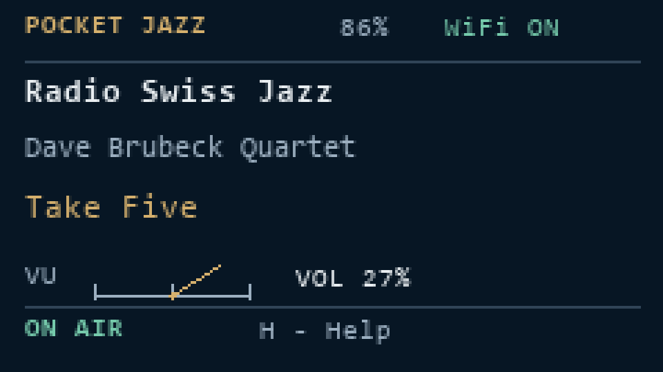
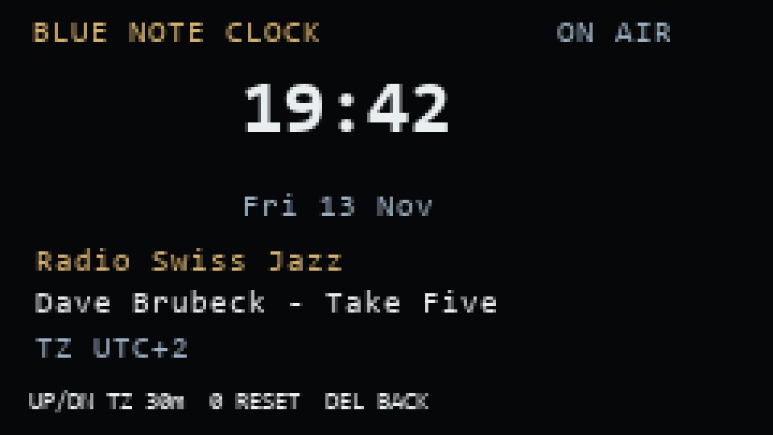
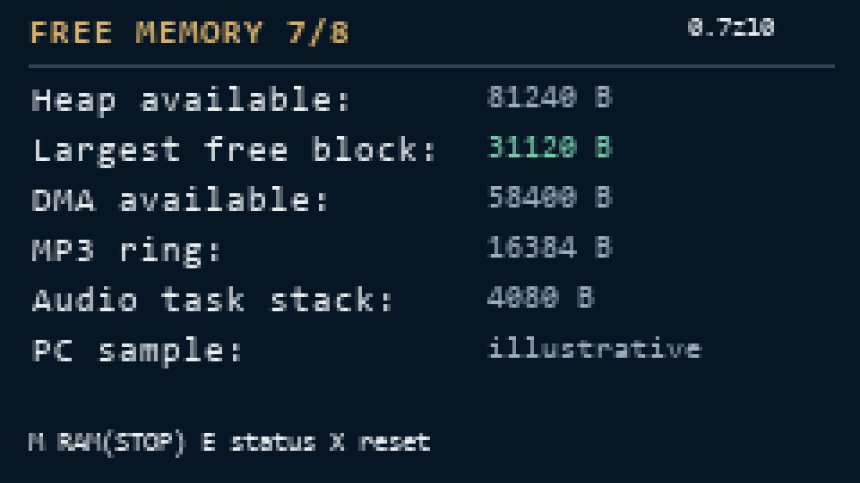
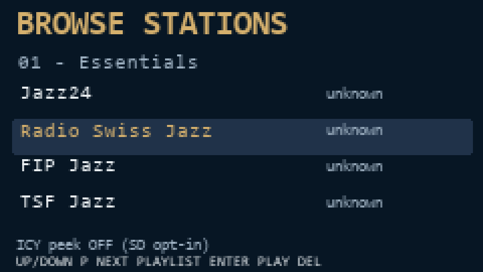
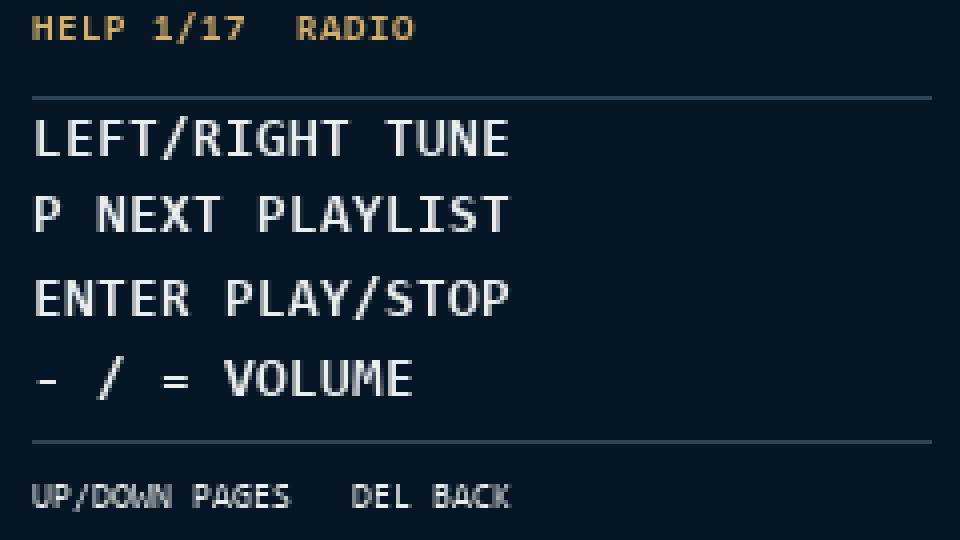

# Pocket Jazz Radio

**Jazz, wherever the Wi-Fi reaches.**

An independent, keyboard-driven internet jazz radio for the **M5Stack Cardputer ADV**.

**[Download v0.7z12 (preview)](https://github.com/lavalava45/cardputer-pocket-jazz-radio/releases/tag/v0.7z12) · [Installation](docs/INSTALL.md) · [User guide](docs/USER-GUIDE.md) · [Changelog](CHANGELOG.md)**

---

Pocket Jazz turns a tiny ESP32-S3 computer into a little radio companion: tune
into jazz stations around the world, browse what's playing, save your favourites,
and explore the music behind the names. No phone, cloud account or subscription
is required for the radio itself.

It is a **work in progress**. The firmware passes software tests and runs on
the Cardputer ADV, but prolonged audio stability, optional sound effects and
the latest display layout still require device testing. This is a public
**preview**, not a finished commercial radio.

## A small screen, a lot of jazz

  
   
  Full-width player layout preview based on the v0.7z10 screen code; not a photograph or verified hardware capture.

| Listen | Explore | Make it yours |
| :--- | :--- | :--- |
| Direct MP3/ICY streams over Wi-Fi | Station search, history and curated groups | Nine quick presets |
| ICY artist/track titles when provided | Jazz Notes and an offline music encyclopedia | Personal M3U playlists on microSD |
| Compact VU, clock and sleep timer | Jazz Spark facts and mood browsing | Likes, optional QR lookups and settings backup |
| Buffering/reconnect diagnostics | Offline MP3s on microSD | Two Wi-Fi profiles and an optional radio alarm |

### Four views

<table>
  <tr>
    <td width="50%"> <b>Blue Note clock</b> Local time, date and timezone controls.</td>
    <td width="50%"> <b>Diagnostics</b> Connection, memory and audio metrics.</td>
  </tr>
  <tr>
    <td width="50%"> <b>Station browser</b> Move between curated lists and tune in.</td>
    <td width="50%"> <b>On-device help</b> Key commands without a phone.</td>
  </tr>
</table>

Images in this gallery are illustrative **240×135 LCD layout previews**, made from the application's design and labels. They are not photographs or proof of hardware rendering. The [Velxio emulator test](docs/EMULATOR.md) is documented separately.

## Install in a few steps

**Recommended: keep M5Launcher 3.**

1. Download **`PocketJazzRadio-v0.7z12-app-only.bin`** from [v0.7z12 preview](https://github.com/lavalava45/cardputer-pocket-jazz-radio/releases/tag/v0.7z12).
2. Copy it to your microSD card, then launch the BIN using **M5Launcher 3 → SD**.
3. Connect to your 2.4 GHz Wi-Fi from the radio's **W** screen.
4. Optionally copy the curated playlists and Jazz Notes data from the SD package to `/PocketJazz/` on the card. **Back up that folder first, and never overwrite `04-my-stations.m3u`.**

If M5Launcher asks to replace its bootloader or repartition the device,
**cancel**. This app does not need either change.

**Want a standalone install instead?** The older **v0.7z10** has an optional
complete-flash image for M5Burner, documented under
[Advanced installation](docs/INSTALL.md#alternative-standalone-m5burner-installation).
It is **not v0.7z12**, replaces M5Launcher and may erase NVS/user flash
data. The new preview is distributed **app-only**.

**[Complete installation and SD guide](docs/INSTALL.md)**

## Controls at a glance

| Keys | Action |
| --- | --- |
| **← / →** | Previous / next station |
| **P** | Next playlist |
| **Enter** | Play / stop radio |
| **− / =** | Volume down / up on every screen; Fn+keys in text-entry fields |
| **1–9 / Fn+1–9** | Recall / save a station preset |
| **F / Tab** | Browse / search stations |
| **H** | On-device help |
| **C / T / Fn+T** | Clock / sleep timer / alarm |
| **I / W / B** | Diagnostics / Wi-Fi / settings backup |
| **S** | Optional tuning sounds (both OFF by default) |
| **U / Z / G** | Jazz Notes / Jazz Spark / mood selector |
| **0 / K / Y** | Offline MP3 / like current track / ICY title history |
| **D** | Manually check/update five default playlists from GitHub, after STOP |

The **V** key no longer hides the VU. It is now always visible in a small
footer; the main text receives the full available display width.
For context-sensitive commands and safe-boot controls, see the
[full key reference](docs/USER-GUIDE.md#keyboard-reference).

## A catalog you can inspect

Five curated playlists contain **56 primary MP3 stations** and
**six alternate URLs**. A [dated PC verification report](checks/pc-stream-check-20261113.json)
recorded 62 successful HTTPS/MP3 checks on 13 November 2026. These checks
**do not guarantee** every stream will keep playing on real hardware.

The editorial lists live in [`catalog/`](catalog/) with a
[versioned SHA-256 manifest](manifest.json). Your private
`04-my-stations.m3u` is **not** uploaded here. The firmware currently
supports up to **64 stations across 12 playlists**.

In **v0.7z12**, **D → Enter** initiates a *manual* verified HTTPS check
and update of just the five editorial M3U files, **only while audio is
stopped**. The updater checks the manifest, sizes, SHA-256, station limits
and real playlist activation. It keeps a rollback journal and never
targets personal M3U/PLS, Jazz Notes, offline MP3 or backups.
**No scheduled or automatic background updates.** See
[catalog instructions](docs/CATALOG.md).

## For makers and developers

The [`firmware/`](firmware/) directory contains the **v0.7z12 software-preview source**,
including the pinned project dependencies, tests and build scripts. The
firmware uses M5Unified, an adapted ESP8266Audio/libmad pipeline and
verified HTTPS. The compressed MP3 input ring selects **16 or 32 KiB**
according to available internal heap; no PSRAM is required.

The new version adds an explicitly bounded 8-KiB first-stream prefill
goal for either 16/32-KiB compressed ring, without unconditionally
increasing the ring allocation. **This is not a proof of stable audio.**
Hardware audio, catalog updates on actual FAT SD, and the LCD still
require acceptance. See
[development and verification notes](docs/DEVELOPMENT.md) and
[release history](CHANGELOG.md).

Original firmware code is **GPL-3.0-or-later**, with additional licenses
for bundled dependencies; original catalog tools and metadata use MIT.
See [license and copyright notes](firmware/COPYRIGHT-NOTICES.md).
The project is not affiliated with M5Stack or any broadcaster.

**Contributions:** station fixes, playback traces and reproducible bug
reports are welcome. [Read the contribution guide](CONTRIBUTING.md).
