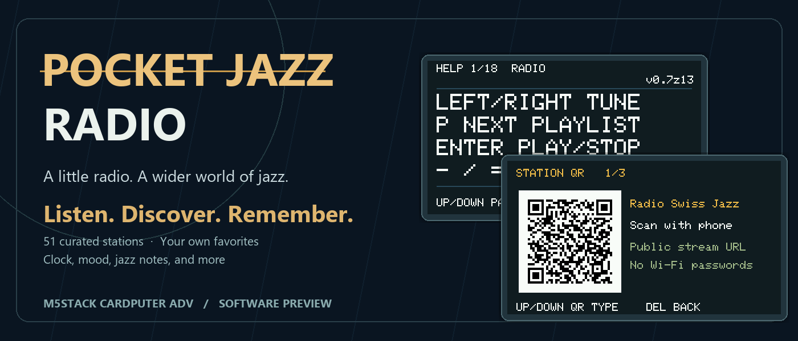
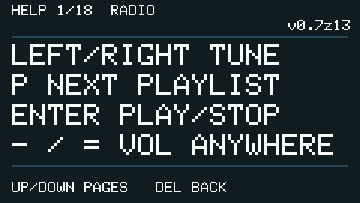
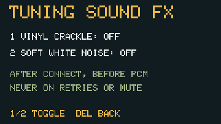

# Pocket Jazz Radio

### Not just another internet radio. A pocket-sized journey through jazz.

*A little radio. A wider world of jazz.*

**Turn your M5Stack Cardputer ADV into a tiny, personal jazz companion.**

Listen. Discover. Remember. No streaming account, phone app or subscription required.

**Jazz Notes editorial update (16 Nov 2026, wave35):** [1,277 individually source-reviewed musician histories and an optional updated SD search index](editorial/jazz-notes/README.md), independently downloadable on `main`. The original **v0.8.0 firmware and seven release assets are unchanged**; its compiled Now Playing hints remain at 595 until a later, separately tested firmware build. The latest offline data are a *manual*, optional SD update, not an automatic patch.

[**Start in 3 steps**](docs/QUICK-START.md) · [**Why Pocket Jazz?**](docs/WHY-POCKET-JAZZ.md) · [**Explore the features**](docs/FEATURE-TOUR.md) · [**Download the preview**](https://github.com/lavalava45/cardputer-pocket-jazz-radio/releases/tag/v0.8.0)

## Current public preview — v0.8.0 (15 November 2026)

**Release/dev status:** active development sprint closed; issues affecting long-run audio and keyboard reliability remain open. GitHub release and Reddit post are live; **M5Ware submission #8 awaits moderation**, and the full-feature correction was received by its contact form. [Current status and next action](docs/PROJECT-STATUS.md).

**A pocket-sized jazz companion for M5Stack Cardputer ADV.** This release brings the full offline **Jazz Journey (24 lessons)**, **Learn to Listen (30 exercises)**, **Jazz Notes** for **1,498 artists**, source-attributed **Jazz Spark (150 facts)**, **595 exact Now Playing/Explained artist hints**, 36 album recommendations and the current radio, alarm, diagnostics and personal listening features. The curated online catalog remains **51 free-stream stations**.

**Research transparency:** of the 1,498 offline entries, 63 are protected original editorial biographies, 532 more have individual source-checked notes, and 903 still carry the baseline/automatically enriched text without individual historical review. All 903 were triaged: 748 with *source leads* (not verified), 103 with insufficient evidence and 52 ambiguous identity matches. The offline catalog's coverage is complete; historical biography validation is not. No invented claims are attached to those 903.

**Preview limitations:** Intermittent buffering and occasional unresponsive controls are tracked as open issues. This release is not advertised as a fix for either issue. Keep a known-working app-only binary for rollback. Neither the download nor this publication flashes your device, alters its partitions/NVS, or touches your private SD files. See [v0.8.0 release notes](docs/RELEASE-v0.8.0.md) and the [three-step guide](docs/QUICK-START.md).

---

## A radio made for listening, not scrolling

Pocket Jazz feels like having a small jazz station on your desk. Pick a favourite with one key, explore a new sound, look up the musician you are hearing, or keep a track in your listening diary. The tiny screen stays readable, and nearly everything is a keypress away.

It is an **independent, open-source project** designed specifically for the Cardputer ADV. Radio uses freely accessible broadcaster streams over **2.4 GHz Wi-Fi**; extra reading and offline listening features can be kept on a microSD card.

**New to Pocket Jazz?** [Download one ready-to-run BIN, copy it to microSD, and launch from M5Launcher 3](docs/QUICK-START.md). The radio can be tried without installing the optional Jazz Notes library. For the idea behind this little music companion, read [Why Pocket Jazz?](docs/WHY-POCKET-JAZZ.md).

| **Listen** | **Explore** | **Make it yours** |
| :--- | :--- | :--- |
| 51 hand-picked stations in five jazz collections | Jazz Notes artist biographies and Jazz Spark facts | Nine instant station presets |
| Direct station search and browsing | Mood Tuner and manual Tap Tempo | Your own stations, likes and offline MP3s |
| Track titles when broadcasters provide them | Recent tracks and QR lookups | Clock, sleep timer and daily radio alarm |

## Real screens, from real firmware in an emulator

The frames below come directly from the **240 × 135 LCD of the v0.7z13 firmware running in [Velxio](https://velxio.dev/example/cardputer-adv-m5-display)**. The images are deliberately kept **compact (360 px wide)** instead of being stretched across the page. They are not drawings or photographs of the physical Cardputer. The emulator had no personal SD library or Wi-Fi connection, so some screens show offline or empty states.

<table>
<tr>
<td align="center" width="50%"> <b>Station browser</b> Discover another station without interrupting the one you are listening to until you press Enter.</td>
<td align="center" width="50%"> <b>Share by QR</b> Scan a public station link with your phone, or open a song search after saving a like.</td>
</tr>
<tr>
<td align="center"> <b>Blue Note clock</b> A quieter screen for time, with sleep and alarm options close at hand.</td>
<td align="center"> <b>Built-in help</b> 18 pages of controls available right on the keyboard.</td>
</tr>
<tr>
<td align="center"> <b>Mood Tuner</b> Move between gentle and energetic, acoustic and electric, and pick a matching tagged station.</td>
<td align="center"> <b>Tuning ambience</b> Optional vinyl crackle and soft hiss while a station starts — off by default.</td>
</tr>
</table>

[**See more actual emulator screens and the full guided tour →**](docs/FEATURE-TOUR.md)

## What you can do

### 01. Travel through jazz

Explore **five curated collections**: Essentials, Modern Jazz, Mellow & Bossa, Swing & Vocals, and Latin & Soul Jazz. Move between stations, search by name or browse freely. Save nine favourite stations and recall them without a menu.

The editorial catalog is updated separately from the firmware. You can request a **verified, manual refresh directly from GitHub** when playback is stopped. Want something different? Add your own compatible radio stations on microSD.

### 02. Remember the music

When a broadcaster supplies a song title, Pocket Jazz shows it on the radio screen. Keep a short history of recent track announcements, press **K** to save a discovery in your own listening diary, or bring up a QR code to search for it using Spotify or Google.

The QR code **starts a web search**; it does not automatically recognise a recording, control Spotify or edit your playlists.

### 03. Discover the people behind the records

A surprisingly deep offline listening companion fits inside this little machine. Search an **artist directory of approximately 1,498 entries**, with 63 original and 532 individually sourced additional editorial notes. Read **150 jazz facts and 25 attributed quotations** in Jazz Spark. Try the **Mood Tuner** for a different listening direction, or tap out a rhythm to estimate its BPM.

The reading library is available when the accompanying microSD data files are installed. The mood descriptions are editorial, not automatic AI genre detection.

### 04. Make an everyday ritual

The **Blue Note clock**, **30/45/60-minute sleep timer**, gentle **daily radio alarm**, automatic screen dimming and always-accessible volume keys make Pocket Jazz useful beyond a quick demonstration. The alarm needs the Cardputer **left powered on**; it cannot turn on a switched-off device.

### 05. Keep control of your own collection

Bring up to **24 local MP3 files** from a microSD folder, remember up to **two Wi-Fi profiles**, maintain your own stations, and export or restore selected settings manually. Personal playlists and likes belong to you; the official online catalog updater deliberately does not replace them.

[**The complete feature tour — listening, library, favourites, clock, controls, offline music and more →**](docs/FEATURE-TOUR.md)

## Getting started

**Recommended: keep M5Launcher 3 and install an app-only BIN.**

For the shortest installation, follow the **[three-step quick start](docs/QUICK-START.md)**. The optional offline Jazz Notes and Spark files are explained there too.

1. Download the [**public v0.8.0 Jazz Journey preview**](https://github.com/lavalava45/cardputer-pocket-jazz-radio/releases/tag/v0.8.0). Select the **app-only** BIN, not an 8 MB full-flash image.
2. Copy it onto your microSD card and open it from **M5Launcher 3 → SD**. Do not replace the launcher, bootloader or partitions.
3. Press **W** to connect to your **2.4 GHz Wi-Fi**.
4. For the full Notes, Spark and curated playlist experience, copy the optional files to **/PocketJazz/** after making a backup. **Never overwrite your personal 04-my-stations.m3u.**
5. Once connected, stop playback, then select **D → Enter** to request the current verified editorial catalog from this GitHub repository. This operation does **not** install a new firmware version.

[**Step-by-step installation and SD safety guide →**](docs/INSTALL.md)

### Your first shortcuts

| Key | What it does |
| :--- | :--- |
| **← / → · Enter · P** | Tune stations, play/stop, switch collections |
| **F · Tab · G** | Browse stations, search by name, choose by mood |
| **1–9 · Fn+1–9** | Recall or save a favourite station |
| **Y · K · Q** | Recent track titles, save a like, open QR choices |
| **U · N · Z · J** | Search Jazz Notes, current artist, Jazz Spark, Tap Tempo |
| **C · T · Fn+T** | Blue Note clock, sleep timer, daily alarm |
| **0 · W · I · H** | Offline MP3s, Wi-Fi, diagnostics, on-device Help |
| **− / =** | Volume down/up on most screens; **Fn** in text-entry fields |

[**Every shortcut and screen explained →**](docs/USER-GUIDE.md#keyboard-reference)
### One-key incident report, not a photo hunt

When a broadcaster stalls or `BUFFERING` recurs, remember the station and let playback stop before recording diagnostics. On **v0.8.0**, press **I → R** (from any Diagnostics page) after **STOP**. Pocket Jazz saves a new `/PocketJazz/incident-*.tsv` containing the station name, recent ICY metadata, Wi-Fi/HTTPS and audio measurements, the last 16 runtime events, and heap/source checkpoints. **No background SD writes** occur during playback. Check for `END complete=1`; incomplete files cannot be trusted as full incident records. The SD write itself still needs real Cardputer testing.

This is a **reporting improvement**, not a fix for upstream stalls. Keep the v0.7z15 or your earlier known-working app-only BIN on the same card for rollback. Photos are useful for visual UI bugs, but numerical debugging should not require screenshots.

## An evolving preview

**Current preview: v0.8.0.** The old v0.7z16 diagnostics improvements are preserved, while the wider Jazz Journey and the expanded offline encyclopedia are new. The image gallery shows actual **v0.7z13 emulator captures**, not the new v0.8.0 running on a physical Cardputer. Known BUFFERING and intermittent input issues are tracked in GitHub issues #1 and #2. Keep your working BIN as a fallback, and see the [v0.8.0 release notes](docs/RELEASE-v0.8.0.md).

The [Velxio Cardputer ADV emulator](https://velxio.dev/example/cardputer-adv-m5-display) was used to inspect earlier display layouts and navigation; the gallery is labelled v0.7z13 rather than v0.8.0. Read [image provenance](docs/EMULATOR.md), follow the [audio reliability issue](https://github.com/lavalava45/cardputer-pocket-jazz-radio/issues/1), or inspect the [changelog](CHANGELOG.md).

For makers: contributions, verified stream suggestions and reproducible fixes are welcome. See [CONTRIBUTING.md](CONTRIBUTING.md) and [development notes](docs/DEVELOPMENT.md). Firmware licensing is GPL-3.0-or-later with bundled notices; catalog tools and metadata are MIT. This independent project is not affiliated with M5Stack, Spotify or any broadcaster.

<strong>Small radio. Big listening.</strong>

