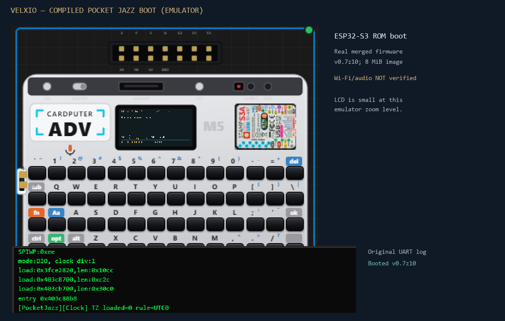

# Emulator and image provenance

The application has been booted as an **actual compiled ESP32-S3 BIN**
in the web-based **Velxio Cardputer ADV simulator**. Its UART log showed
the ESP-ROM boot sequence and `[PocketJazz][Clock] TZ loaded=0 rule=UTC0`.
The simulator reported that the uploaded merged firmware was 8 MiB.

*A documented crop/composite of the actual v0.7z10 Velxio browser
session, showing the virtual Cardputer and its UART output. Unlike the
five README previews, this image comes from an actual emulator run.
It is not a photograph of a physical device.*

This is useful for checking certain screen and keyboard paths, but:

- The simulator had no matching Wi-Fi credentials for the radio.
- Internet streams, verified TLS on real Wi-Fi and ES8311 speaker
  timing were **not** accepted by this test.
- An 8-MiB merged image was used **only inside the emulator**. Do not
  flash it over a Cardputer running M5Launcher 3.
- The simulator's 3D camera scales the LCD down; a generic cropped
  screenshot from it is not suitable as a legible primary feature image.

The README's four images use **source-derived 240×135 layout previews**
for readability. They show the intended geometry and labels, but do
not claim exact M5GFX glyph metrics or physical LCD acceptance.
This distinction is important because the new full-width player
in v0.7z10 has passed host/layout checks but still needs a real screen
inspection.

Reference: [Velxio Cardputer ADV example](https://velxio.dev/example/cardputer-adv-m5-display).
