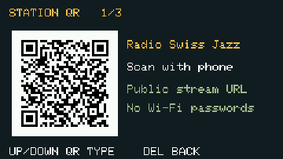

# Emulator screenshots: origin and limitations

## Current documentation gallery: firmware v0.7z13

The screenshots on the [README](../README.md) and [Feature Tour](FEATURE-TOUR.md) are **actual display frames emitted by an ESP32-S3 binary running in Velxio**, not speculative layouts.

For this documentation pass, the simulator ran **the locally tested v0.7z13 firmware candidate** in an isolated, **headless browser session**. No real Cardputer, user SD files, Wi-Fi passwords, M5Launcher instance or physical flash were accessed.

The input was an **8,388,608-byte emulator-only merged image** constructed from the local build. Its application segment at offset 0x10000 was compared byte-for-byte with the immutable v0.7z13 app-only release candidate:

| Capture fact | Verified value |
| :--- | :--- |
| Device in Velxio | M5Stack Cardputer ADV, ESP32-S3 |
| Firmware | Historical local v0.7z13, **not the newer public v0.7z16 download** |
| App-only SHA-256 | e4048df599d06019e2d6abf22ce92cebe805eb286317b5176ed2008576f97516 |
| Emulator-only merged SHA-256 | 11214c1a9a0498878242e1315af6f3fe8c42668aee22783a125001dd648c3654 |
| Raw LCD source | 240 × 135-pixel Velxio canvas |
| Gallery display size | 360 × 203 pixels, saved at that size |
| Scaling technique | One nearest-neighbour resampling pass, **no HTML stretch to 700 px or full-page width** |
| Captured views | Radio, station browser, QR, Blue Note clock, Mood Tuner, tuning sounds, Help and Diagnostics |

The simulator loaded the image as a binary, booted the virtual ESP32-S3, and the serial log contained the **[PocketJazz][Clock]** startup event. The Help screen itself displays **v0.7z13**. The screen content was taken directly from the simulator's LCD canvas. The descriptive cover image on the README is an **editorial composite of the actual Help and QR captures**, with surrounding typography and decoration added separately; it is not itself a single screenshot.

### What the screenshots show

<table>
<tr><td></td><td>Radio in the emulator's offline Wi-Fi state. Player layout, volume and VU area are visible.</td></tr>
<tr><td></td><td>On-device Help 1/18 with the current candidate firmware label.</td></tr>
<tr><td></td><td>Public stream URL sharing for the built-in Radio Swiss Jazz entry.</td></tr>
<tr><td></td><td>Mood grid without the optional SD tags; it correctly reports the missing dataset.</td></tr>
</table>

More individual captures appear in the [Feature Tour gallery](FEATURE-TOUR.md#screens-from-the-real-emulator).

### What they do not prove

Velxio in this session had **no matching Wi-Fi profile and no personal SD assets**. Radio Swiss Jazz on the display is an entry from the built-in fallback list, **not evidence of its successful audio playback**. An unset clock, missing Jazz Spark data or no tagged Mood Tuner stations are expected for that test environment.

Neither these screenshots nor host unit tests establish verified TLS over the actual home Wi-Fi network, broadcaster uptime, physical microSD reliability, ES8311 speaker behaviour, headphone output, or uninterrupted audio. A physical v0.7z13 trial restored keyboard responsiveness and showed improved audible playback, but a **BUFFERING interruption remains** under investigation.

**Never flash the emulator-only merged image** onto a physical Cardputer, M5Launcher or PMan. It includes test bootloader/partition data and is for emulation only. Normal use retains M5Launcher 3 and uses an **app-only BIN**.

## Earlier visual references

The repository also retains older **source-derived layout previews** and the [v0.7z10 Velxio browser capture](images/velxio-boot.png), as historical development material. The older preview PNG files (radio-preview.png, clock-preview.png, diagnostics-preview.png, browse-preview.png and help-preview.png) are **not used as the current README gallery**. Their content was a design/layout illustration, not the current v0.7z13 emulated screen.

The public feature tour distinguishes these actual emulator frames from hardware photographs, UI design mockups and real audio acceptance.

Velxio simulator reference: [Cardputer ADV M5 display example](https://velxio.dev/example/cardputer-adv-m5-display).
