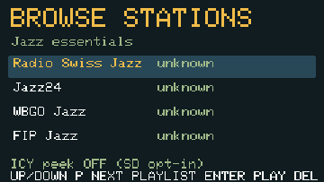
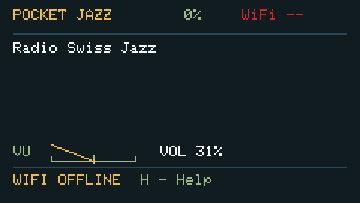
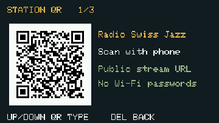
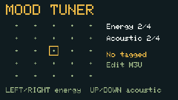
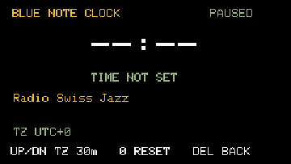
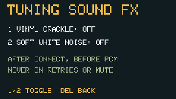
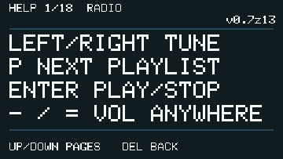
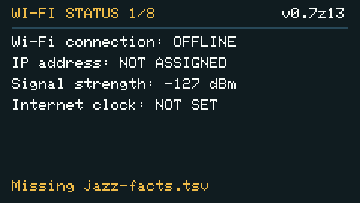

# Feature Tour

## A pocket-sized radio with room for curiosity

Pocket Jazz Radio brings the familiar pleasure of tuning a radio into a tiny open-source companion for the **M5Stack Cardputer ADV**. A real keyboard, a small colour screen and a speaker are enough to explore jazz, save discoveries and learn more about the music — without turning the experience into another phone app.

This is a guided tour of **features implemented in the application**, not a promise that every feature has completed long-duration hardware acceptance. The publicly downloadable diagnostic preview is **v0.7z15**; the real emulator screenshots remain from the previously tested local **v0.7z13** candidate. The curated catalog described here is version **2026.11.14.1** and currently contains **51 stations**.

[**Home**](../README.md) · [**Start in 3 steps**](QUICK-START.md) · [**Why Pocket Jazz?**](WHY-POCKET-JAZZ.md) · [**Full controls**](USER-GUIDE.md) · [**Image provenance**](EMULATOR.md)

---

## 1 · The radio: a world of jazz, one key away

There is something satisfying about choosing a radio station rather than searching for a specific track. Pocket Jazz makes that moment simple: **left and right** to tune, **Enter** to play or stop, and **P** to move through playlists. You can also open the station browser with **F** without changing the sound until you decide what to play.

The editorial collection has five moods of its own:

| Collection | Stations | Where it takes you |
| :--- | ---: | :--- |
| **Jazz Essentials** | 15 | A welcoming starting point for jazz listening |
| **Modern Jazz** | 10 | Contemporary sounds, fusion and adventurous programming |
| **Mellow & Bossa** | 12 | Quieter moods, Brazilian colour and late-night listening |
| **Swing & Vocals** | 10 | The energy and storytelling of vocal jazz and swing |
| **Latin & Soul Jazz** | 4 | Rhythm-forward jazz and its neighbouring styles |
| **Total** | **51** | The current online editorial catalog |

The collection is **curated, not exhaustive**. Broadcasters may change their schedules, and a working link today is not a guarantee of tomorrow's stream. The editor can remove stations that have drifted away from jazz without requiring everyone to install new firmware.

 Real LCD frame: browse stations before committing to a change. The emulator has no SD station files, so it shows the built-in fallback list.

**More ways to choose:** press **Tab** to search the loaded station names, **1–9** to recall any of nine presets, or **Fn+1–9** to save a station into one of those slots. The **L** screen brings back recently played stations. An optional background peek at titles from other visible HTTPS stations exists but is **off by default** and must be explicitly enabled in SD settings.

## 2 · A player that knows when it is waiting

The radio screen keeps the essentials close: station name, current state, volume and a compact signal-inspired level meter. When a broadcaster supplies an ICY track title, the screen can show the **artist and song**; when no title is supplied, Pocket Jazz does not invent one.

The state display distinguishes getting connected, buffering, playing and retrying after a stream failure. A configured alternate URL can provide a second route to the same broadcaster. These safeguards help explain what the radio is doing; they do not eliminate the possibility of a stalled server or a quiet moment while buffering.

 Real LCD frame: the latest full-width radio layout in the offline emulator. The unavailable Wi-Fi connection is shown explicitly.

Volume controls work on the radio and most other screens. The VU display stays available without taking space away from long station or track names. After a period of inactivity the backlight dims, and a press wakes the interface without accidentally tuning away.

## 3 · Remember a great track

Radio introduces you to music you did not know you were looking for. When the station sends track metadata, Pocket Jazz keeps a short **in-session history of up to five recent announcements**. **Y** opens that history.

**K** saves the current discovery to your personal **liked.txt** on the microSD card. That file is yours: the program does not send it to a music service. **Q** can display the station's public URL as a QR code, or offer a **Spotify/Google web search** for the last liked title.

 Real LCD frame: a scan-ready QR code for Radio Swiss Jazz. Spotify and Google options are search links, not account integrations.

**The important distinction:** Pocket Jazz does not identify a song by listening to the audio, control Spotify, or automatically add songs to a playlist. It helps you **keep and follow up on the titles broadcasters actually provide**.

## 4 · Meet the musicians: Jazz Notes

A record becomes more interesting when you know who is playing. **Jazz Notes** turns the Cardputer into a little offline reference library. Press **U** to search an artist name; use **N** for a note about the current artist when a suitable title is available.

With the optional SD dataset installed, the main directory offers approximately **1,498 artist entries**. **63 musicians have extended editorial biographies**, while many of the other entries are shorter reference cards. A smaller fallback collection can be used when the full directory is absent.

This is not a live Wikipedia browser or a generative AI service. The notes are stored on your card and can be read even when the internet is not available.

## 5 · Unexpected discoveries: Jazz Spark

Sometimes all you need is one fascinating detail. **Jazz Spark**, opened with **Z**, contains **150 editorial jazz facts and 25 attributed quotations**, supplied as optional offline files. Browse them yourself or enable occasional automatic cards.

The facts do not interrupt the heart of the radio whenever they please: automatic display is designed to defer when navigation or audio conditions make it inappropriate. The user remains in control.

## 6 · Choose a mood, or tap a beat

Not every listening session starts with the name of a station. **Mood Tuner** (**G**) helps you find one based on a simple grid: from **relaxed to energetic** in one direction, and **acoustic to electric** in the other. The nearest tagged station becomes the suggestion.

 Real LCD frame: Mood Tuner with no SD mood-tagged stations loaded in the emulator. On a prepared card, the editor's mood tags drive selection.

These are **editor-supplied mood tags**, not automatic analysis of a broadcaster's music. If there are no suitable tags, the screen tells you rather than pretending to have found a match.

**Tap Tempo** (**J**) is a small musician's tool: tap along with a recording and the display estimates the tempo in BPM from your taps. It does **not** automatically measure BPM from the digital audio stream.

## 7 · A clock, a timer and a gentler morning

A dedicated music device can belong on a bedside table, too. **Blue Note Clock** (**C**) provides a deliberately quiet display. The clock synchronizes time using the internet and can use a fixed UTC offset or a timezone rule from SD, including daylight-saving adjustments where configured.

 Real LCD frame: when the emulator has no synchronized time, the clock correctly says TIME NOT SET instead of displaying a fictitious date.

**T** on the radio cycles through **30, 45 and 60 minutes** of sleep timer, then off. **Fn+T** opens the daily radio alarm: choose a local time and a station preset, and the volume can fade up gradually.

The alarm is a **software alarm on an already-running Cardputer**. It will not power on a device that has been turned off, and it should not be treated as a safety-critical wake-up system.

## 8 · A little vinyl atmosphere, when you want it

Pocket Jazz can play **subtle vinyl crackle or a soft hiss** while a connection is being established, **before the station's first PCM audio begins**. These sounds are optional, individually switchable, and both are **off by default**.

 Real LCD frame: both optional tuning effects disabled. They are not layered over the live music.

The ambience is deliberately conservative; it does not mix over an already playing station, and the software can omit it when there is insufficient memory headroom. Full sound-quality acceptance remains an open hardware task.

## 9 · Your stations and your offline music

Not every listener has the same favourites. Edit your own playlist on microSD and let Pocket Jazz load it alongside the official five. The private **04-my-stations.m3u** is yours, and the official catalog updater is specifically designed to **leave it alone**.

For the times when Wi-Fi is unavailable, **0** opens a manual offline MP3 library: up to **24 compatible MP3 files** under the optional **/PocketJazz/offline/** folder. Use the keyboard to choose a file and play it locally through the Cardputer speaker.

This is a **manual offline mode**, not background caching, recording radio or automatic fall-back from an internet stream.

The software supports up to **64 loaded stations across 12 playlists** in the current design. Adding personal stations therefore shares that capacity with the official catalog.

## 10 · A catalog that improves without reflashing

The curated lists live openly in this GitHub repository under [catalog/](../catalog/). The current editorial catalog contains **51 stations and four backup stream URLs**. After a Wi-Fi connection is ready, stop all playback, press **D** on the radio screen, and confirm with **Enter** to request a fresh version.

The updater checks that it has received the expected files before applying the changes. It is **manual**, updates only the five official playlists, and is separate from installing a firmware BIN. Personal playlists, offline music and private listening records are excluded from its target list.

A backup of your SD folder is still sensible before the first update. Actual power-loss recovery on all SD cards is not fully proven by desktop software tests.

## 11 · Your own small setup

Pocket Jazz can remember **two Wi-Fi profiles** and reconnect when a known network is available. **W** opens Wi-Fi setup, while saved presets, clock preferences and selected settings can persist across restarts.

Selected settings can be **backed up or restored manually** after playback stops. This is not an automatic cloud account or a full mirror of the SD card, and the backup does not include your private Wi-Fi passwords or personal station playlists.

The interface is made for the Cardputer: compact screens, the original keyboard, an automatically dimming backlight and **18 pages of on-device Help**.

 Real LCD frame: Help 1/18, including the v0.7z13 firmware label.

## 12 · See what the radio is doing

**I** opens the diagnostics pages, where you can inspect network status, stream conditions, memory and other useful observations. Under difficult network conditions, these help distinguish a connection failure from a buffering or memory problem.

 Real LCD frame: network diagnostics in the offline emulator. No IP address or synchronized clock is claimed.

Diagnostic exports are initiated by the user and written to SD. The application does not continuously upload technical records to a server. Do not publish personal SD backups or credentials in public bug reports.

---

## Screens from the real emulator

All of the following screenshots were captured from the **actual running v0.7z13 8 MB emulator-only image**, with its application segment verified byte-for-byte against the v0.7z13 app-only BIN. The original Velxio LCD canvas was exactly **240 × 135 pixels**. Gallery versions are scaled once using nearest-neighbour resampling to **360 × 203 pixels** and displayed at that same width — never blown up to fill the entire page.

| Screen | Screenshot |
| :--- | :--- |
| Radio, offline |  |
| Station browser |  |
| QR sharing |  |
| Blue Note clock |  |
| Mood Tuner |  |
| Tuning effects |  |
| On-device Help |  |
| Diagnostics |  |

**Evidence boundary:** Velxio lets us inspect display and keyboard paths but does not establish real Wi-Fi certificate verification, broadcaster availability, SD timing, ES8311 speaker output or uninterrupted audio on the physical Cardputer. Read [the capture provenance and limitations](EMULATOR.md) for details. The v0.7z13 emulator capture is not a screenshot of the current v0.7z15 public preview.

## The shortest route through the keyboard

| Press | To |
| :--- | :--- |
| **← / →, Enter, P** | Choose a station, play or stop, switch playlists |
| **F / Tab** | Browse or search stations |
| **1–9 / Fn+1–9** | Recall or save one of nine presets |
| **G / J** | Mood Tuner / manual Tap Tempo |
| **Y / K / Q** | Track history / save a like / QR sharing and searches |
| **U / N / Z** | Jazz Notes search / current artist / Jazz Spark |
| **C / T / Fn+T** | Blue Note clock / sleep timer / daily alarm |
| **0 / W / I / H** | Offline MP3 / Wi-Fi / diagnostics / Help |
| **B / D / R** | Settings backup / manually update online catalog / reload SD playlists |
| **− / =** | Volume; in text-entry fields use **Fn** for volume |

On the radio screen, **Enter stops or starts the live stream**; it is not a timeshift pause. There is currently **no rewind-live-radio feature**, automatic Spotify playlist sync, AAC/HLS streaming, automatic offline fallback, or built-in cloud assistant.

[**Install safely**](INSTALL.md) · [**Full reference guide**](USER-GUIDE.md) · [**Back to the project home**](../README.md)
