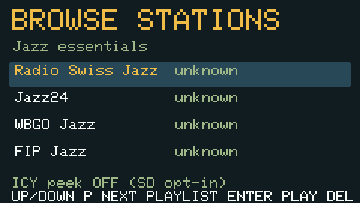

# Pocket Jazz Radio — playing in three steps

**A small jazz radio for the M5Stack Cardputer ADV. No compiler needed.**

This is the shortest route to the current **v0.7z14 diagnostic preview** using an **already installed M5Launcher 3**. You do not need to replace the bootloader, erase your device, or build the program from source.

Actual emulator display from v0.7z13, not a photograph of v0.7z14 on physical hardware.

## Download → Copy → Launch

1. **Download** [`PocketJazzRadio-v0.7z14-app-only.bin`](https://github.com/lavalava45/cardputer-pocket-jazz-radio/releases/download/v0.7z14/PocketJazzRadio-v0.7z14-app-only.bin) from the [official preview release](https://github.com/lavalava45/cardputer-pocket-jazz-radio/releases/tag/v0.7z14). Choose the **app-only BIN**, not a merged/full-flash image.
2. **Copy** that BIN to your Cardputer's **microSD card** using a card reader or your existing launcher file-transfer workflow. Keep any older working Pocket Jazz BIN on the card as a fallback.
3. **Launch** **M5Launcher 3 → SD**, select the Pocket Jazz BIN and use the launcher's normal app-install/run flow.

**First time listening?** Press **W** in Pocket Jazz, connect to **2.4 GHz Wi-Fi**, then choose a station and press **Enter** to start or stop it. Press **← / →** to change stations, **P** to change collections, **− / =** for volume, or **H** for help. A station needs an available MP3 stream and a working network connection.

**That's enough to try the radio.** You do *not* need the extra Jazz Notes data for basic station playback. Without a prepared SD library, the device may display its built-in fallback stations instead of all **51** curated stations.

## Want the complete experience? Add the optional SD library

The same release includes [`PocketJazzRadio-v0.7z14-Launcher3-SD.zip`](https://github.com/lavalava45/cardputer-pocket-jazz-radio/releases/download/v0.7z14/PocketJazzRadio-v0.7z14-Launcher3-SD.zip). It contains the **same app-only BIN**, the five editorial station playlists, a *blank example* personal playlist and these extra files:

| Copy into `/PocketJazz/` | What it unlocks |
| --- | --- |
| `jazz-encyclopedia.tsv` | The expanded offline artist directory for **Jazz Notes** (**U**) |
| `artist-notes.tsv` **and** `artist-notes.idx` | Indexed legacy artist notes; **keep the pair together** |
| `jazz-facts.tsv` | Offline **Jazz Spark** facts (**Z**) |
| `01-essentials.m3u`, `02-modern-jazz.m3u`, `03-mellow-bossa.m3u`, `05-swing-vocals.m3u`, `06-latin-soul-jazz.m3u` | The five curated collections, **51 stations** in the current catalog |

**Important: back up your existing `/PocketJazz/` folder before copying anything.** The ZIP contains `04-my-stations.m3u` as an **empty example**. **Never overwrite your own file** with it. Do not extract the ZIP wholesale over an existing `/PocketJazz/` folder. Copy only the individual missing or intentionally updated files.

You can instead refresh the **five official playlists** from inside Pocket Jazz: once Wi-Fi and time are ready, **stop radio/offline playback → D → Enter**. This manual catalog update does not install firmware or replace your private playlist. It does **not** download the separate Notes and Spark data files.

## Three things to know before trying the preview

- **Hardware:** designed for the **M5Stack Cardputer ADV**. Compatibility with earlier Cardputer models is not established.
- **Preview status:** v0.7z14 passed software tests and booted in an emulator, but its **physical speaker/audio stability is still awaiting testing**. Some stations can buffer or become unavailable; [audio issue #1](https://github.com/lavalava45/cardputer-pocket-jazz-radio/issues/1) remains open.
- **Safe rollback:** keep your previous working app-only BIN (for the developer, v0.7z13), and select it again through M5Launcher 3 if the new version is worse. Do not use an 8 MB merged emulator image, reflash M5Launcher, change partitions or erase NVS.

For questions about Wi-Fi, timezones, file locations or errors, see the [full installation instructions](INSTALL.md). For the story behind the project, see [Why Pocket Jazz?](WHY-POCKET-JAZZ.md), or take the [feature tour](FEATURE-TOUR.md).
