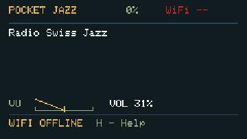
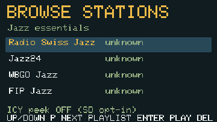
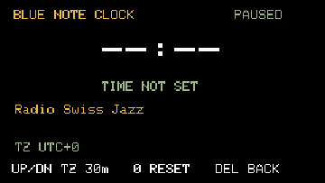
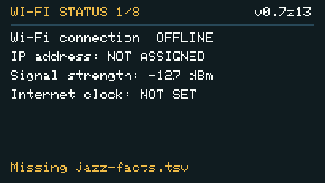

# Pocket Jazz Radio — User Guide

This guide covers the publicly available **v0.7z12 software preview**. Some
features require optional microSD assets. Its compact illustrations are **real
v0.7z13 emulator captures** (not photographs of hardware and not screenshots
of the v0.7z12 download). The newer local candidate is still being tested;
see the [Feature Tour](FEATURE-TOUR.md) and [image provenance](EMULATOR.md).

## 1. The radio

*Actual v0.7z13 emulator LCD. The simulator has no connected Wi-Fi.*

The main player uses the full screen width for the **station name** and,
when the broadcaster provides ICY metadata, the **artist** and **track**.
A small VU indicator is always visible near the bottom, alongside
`VOL xx%` and the status line (`CONNECTING`, `BUFFERING`, `ON AIR`,
`RETRYING`, or `STOPPED`). Extremely long titles can still be trimmed.

**Left/Right** changes stations within the current playlist; **P** moves
to the next playlist. **Enter** plays or stops the current stream.
This is live radio, **not** a pause/rewind recorder. **− / =** changes
the volume **from every screen** (including Help, Clock, Diagnostics,
offline MP3, and a dimmed display). In Wi-Fi password, station search,
and Jazz Notes search fields, type `-` and `=` normally; use
**Fn+− / Fn+=** to adjust volume without inserting punctuation.
A sounding daily alarm has its own temporary volume target.
**M** mutes/unmutes from the radio.

## 2. Choose stations and keep favourites

*Actual v0.7z13 emulator LCD showing the built-in fallback stations.*

**F** opens the station browser: **Up/Down** selects an entry, **P**
changes the list being browsed, and **Enter** tunes the highlighted
station. To search for a station by name, return to the **Radio** screen
with **Del**, then press **Tab**. Tab does not open search from Browse.

**1–9** recalls a station preset, while **Fn+1–9** saves the current
station into that slot. **L** displays recently selected stations.
**Y** opens a history of ICY track titles received during the session.
**K** records a like for the current recognized track to
`/PocketJazz/liked.txt` on the SD card.
**Q** provides QR lookup views for the current station or the most
recent liked track; the lookups are searches, **not Spotify integration**
or an automatic playlist add.

The five default jazz groups contain **51 curated stations**.
Add your own stations to `04-my-stations.m3u` without touching the
default lists. Current firmware supports **64 stations / 12 playlists**
total. Press **D** from the radio and then **Enter** to manually check
for updated official playlists over certificate-verified HTTPS, while
radio and offline audio are **fully stopped**. Downloads are validated
against a SHA-256 manifest and activated only after successful SD reload;
otherwise the previous defaults are restored when possible. Nothing
automatically changes the private `04-my-stations.m3u` or other user files.
Back up your SD directory before testing this new feature. Default stream
checks were performed on a PC, not a guarantee
that every server is always available.

## 3. Blue Note clock, timers and alarm

*Actual v0.7z13 emulator LCD. Time is deliberately unset without NTP.*

**C** opens the single clock screen. It shows large local time, date,
a timezone label and radio information. **Up/Down** changes a manual
UTC offset by ±30 minutes; **0** clears the override and returns to a
configured SD timezone or UTC. **Del** returns to radio.

**T** from the radio cycles the sleep timer through 30/45/60-minute
choices and off. **Fn+T** opens the daily radio alarm, where the time,
preset and enabled state can be adjusted. For detailed alarm behavior,
see [the archived alarm specification](../firmware/docs/DAILY-RADIO-ALARM.md).

## 4. Jazz Notes, Spark and mood

**U** opens the offline musician/artist search. The SD encyclopedia
and its index unlock a much larger library than the built-in fallback.
**N** looks up the currently recognized artist when metadata contains
an `Artist - Track` form. These features do **not** query live
music-reference services automatically while playing.

**Z** opens **Jazz Spark**, a browsable collection of short jazz facts.
Spark can optionally rotate on a timer; its source text is stored in
the SD data package. **G** opens the mood-based jazz selector.

## 5. Optional tuning atmosphere

**S** opens the **TUNING SOUND FX** menu. **1** toggles very quiet vinyl
crackle; **2** toggles quiet white noise. **Both are OFF by default.**
They are designed to play briefly during the first connection/prefill,
then fade when the first decoded PCM is accepted. If free memory is tight,
the firmware can skip the effect rather than sacrifice playback.

Holding **S during startup** still requests safe start (no autoplay);
that boot-time shortcut is different from the in-app FX menu.

## 6. Wi-Fi, SD playback and settings

**W** opens the Wi-Fi list. Use **Up/Down** to pick a network and
**Enter** to connect; for a saved network, **Fn+Enter** edits its password.
Two Wi-Fi profiles can be saved.

**0** from the radio opens the local offline MP3 library when available.
Put your own MP3 files under `/PocketJazz/offline/` and stop online
radio first. This is a separate local player, not a timeshift buffer.

**B** opens settings backup: with radio stopped, **E → E** exports and
**I → I** imports a manually confirmed backup. Backups do not include
Wi-Fi passwords, but **station URLs in backups are not encrypted**.
Store and share backups accordingly.

## 7. Diagnostics and reports

*Actual v0.7z13 emulator LCD: Wi-Fi is offline, as expected.*

**I** opens eight diagnostic pages. **Up/Down** changes pages; **Del**
returns. They cover Wi-Fi status/stability, HTTPS stages, compressed
stream buffer/underruns, decoded PCM, playback, memory and system health.

On the appropriate pages, **X** resets displayed counters and **E**
manually exports bounded TSV logs to `/PocketJazz/`. In v0.7z10,
**Memory 7/8 → M** after stopping radio exports staged heap information
to `/PocketJazz/heap-lifecycle.tsv`. There are **no automatic SD logs**
during normal playback.

For a useful bug report, provide the exact version, station and time,
whether another station works, plus the first-failure heap values
(`free8` and `largest8`), ring size, TLS error and buffer level if
available. A successful PC stream probe does **not** prove that the
ESP32-S3 audio path is stable.

## Keyboard reference

| Key | From the radio | Inside a feature |
| --- | --- | --- |
| **← / →** | Previous/next station | Alarm minutes, where shown |
| **Up / Down** | — | Navigate lists, pages or adjust clock offset |
| **P** | Next playlist | Browse another playlist |
| **Enter** | Play / stop | Select or confirm |
| **− / =** | Volume −/+ | Volume everywhere; Fn+− / Fn+= while entering text |
| **M** | Mute/unmute | Memory export on Diagnostics 7/8 (after STOP) |
| **H** | Help (always first page) | — |
| **1–9** | Recall preset | Toggle FX 1/2 when S menu is open |
| **Fn+1–9** | Save preset | — |
| **F / Tab** | Browse / station search | — |
| **C / T / Fn+T** | Clock / sleep / alarm | — |
| **S** | Tuning FX settings | — |
| **I / W / B** | Diagnostics / Wi-Fi / backup | — |
| **U / N / Z / G** | Notes search / current artist / Spark / moods | — |
| **L / Y / K / Q** | Recent stations / track history / like / QR lookups | — |
| **0** | Offline MP3 | Reset timezone override inside Clock |
| **D** | Manual official catalog update confirmation | Enter updates only after audio STOP; Del cancels |
| **Del** | — | Back / cancel |
| **V** | No action | VU stays visible by design |

Use **H** on the device for its current context-aware Help pages.
The firmware is experimental; if the hardware behavior differs from
this guide, please report the exact version and reproduce the issue.
