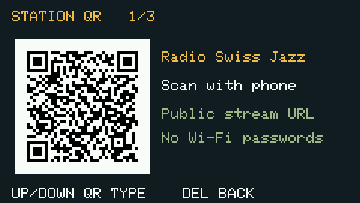

# Why Pocket Jazz?

### A little radio. A wider world of jazz.

There is a different feeling to turning on a radio.

You don't have to decide which album to play, build a queue, or reach for a phone. You choose a station, listen, and let the next tune surprise you. Sometimes it's a familiar recording. Sometimes it's an artist you have never heard of. And sometimes the name on the screen makes you curious enough to look further.

**Pocket Jazz Radio is an attempt to give that simple ritual a home on the M5Stack Cardputer ADV.**

Actual v0.7z13 emulator screen. The current public v0.7z15 preview has not yet completed physical audio acceptance.

## More than a stream list

There are already general-purpose internet radios for small devices. Pocket Jazz makes a different trade-off: rather than trying to play every kind of audio, it gives **jazz and the experience of discovering it** a little more attention.

The starting point is **51 hand-picked radio stations** across five collections — from essentials and modern jazz to bossa, swing, vocals and Latin/soul-inflected sounds. These are real broadcasters, with real schedules that can change. The station directory can be refreshed separately from the firmware, and listeners can keep their own stations alongside it.

But the radio is also a companion for *what happens after an unfamiliar track catches your ear*:

- **Jazz Notes** provides an offline artist directory, with extended editorial notes for selected musicians. It is something to read on the device, not an online AI service.
- **Jazz Spark** offers short musical facts. **Mood Tuner** lets you choose a direction — gentle or energetic, acoustic or electric — using editorial tags.
- When a station supplies artist and track metadata, you can **remember the title**, browse recent announcements, or open a **QR-based web search** later. It does not identify music from sound or control a Spotify account.
- Your own **nine station presets**, local **MP3 files**, **Blue Note clock**, sleep timer and daily radio alarm give the project room to become part of a listening routine.

All of this is designed around the Cardputer's *actual keyboard and tiny display*. Most actions take a single key. No account is required to use the radio; streaming needs Wi-Fi, while the optional reading library lives on microSD.

## Why build for such a small machine?

A dedicated little device has useful limits. It sits on a desk, plays music, shows just enough information and stays out of the way. The Cardputer ADV also makes the engineering interesting: a radio has to share scarce RAM between HTTPS, MP3 decoding, the speaker and the user interface.

That constraint is part of the work, not something to disguise. The project is open source, and the current **v0.7z15 diagnostic preview** includes a measured reduction of **1,672 bytes of static RAM** and extra telemetry for investigating a rare input-buffer stall. On the physical device, an earlier v0.7z13 restored keyboard responsiveness, but a sporadic **BUFFERING** pause remained. The new version is **not yet confirmed to eliminate it**.

Pocket Jazz isn't a finished commercial appliance. It is a small, evolving music project that other Cardputer owners can inspect, try and help improve.

## What I'd love other Cardputer owners to try

Do the stations you enjoy remain reachable? Do the keys respond while music plays? Is the display readable without a phone? Does switching stations feel natural — and what happens if a stream slows down?

Those observations are more valuable than a view count. Reports with the firmware version and station name are welcome, especially from independent users. The [open audio issue](https://github.com/lavalava45/cardputer-pocket-jazz-radio/issues/1) explains the current limitation.

**Try it:** [Three-step quick start](QUICK-START.md) · [Download v0.7z15 preview](https://github.com/lavalava45/cardputer-pocket-jazz-radio/releases/tag/v0.7z15) · [Explore the features](FEATURE-TOUR.md).

---

## Short introduction for a community post

This is a **draft for a project-showcase post**, not a claim that v0.7z15 has passed a physical audio test. Add your own real Cardputer photo or short demonstration video before posting, and check each community's current rules.

**Suggested title:** I built a pocket-sized jazz radio for the Cardputer ADV — with 51 stations and an offline artist library

> I've been working on **Pocket Jazz Radio**, an open-source internet radio for the **M5Stack Cardputer ADV**.
>
> The idea is to keep the experience closer to a tiny dedicated radio than a general-purpose streaming app: pick a station, listen, discover a musician and save a title you want to look up later.
>
> It has **51 curated jazz/jazz-adjacent stations**, keyboard shortcuts and nine presets, plus optional offline **Jazz Notes**, **Jazz Spark**, a mood-based station selector, clock and local MP3 playback. You can also maintain your own station list and update the curated catalog without reflashing.
>
> There's a ready-to-run **app-only BIN for M5Launcher 3**, with no need to replace the launcher. It's still a **preview**: Rare short buffering pauses remain a known, non-blocking limitation, and I haven't yet verified the new v0.7z15 interface/audio on physical hardware. The source and current limitations are public.
>
> GitHub / download: https://github.com/lavalava45/cardputer-pocket-jazz-radio
>
> I'd be interested in hearing what other Cardputer ADV owners think — especially whether station switching, responsiveness and audio continuity work well for you.

**Before sharing:** if you have personally tested v0.7z15 on the Cardputer by then, replace the untested sentence with your *actual observation*, not a generic success claim. The existing screenshots are authentic **v0.7z13 emulator** images and should be labelled as such; a filmed physical device is a separate piece of evidence.
